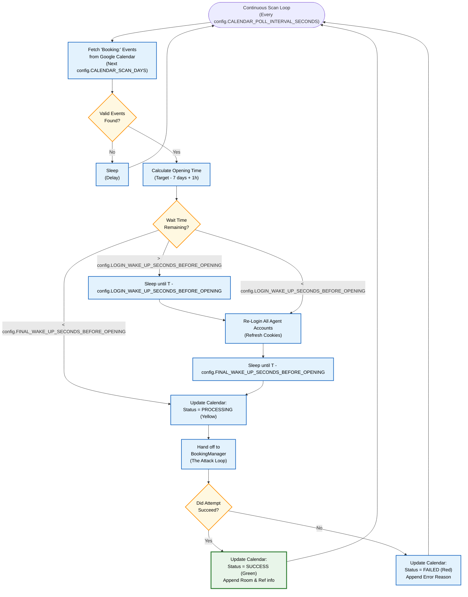
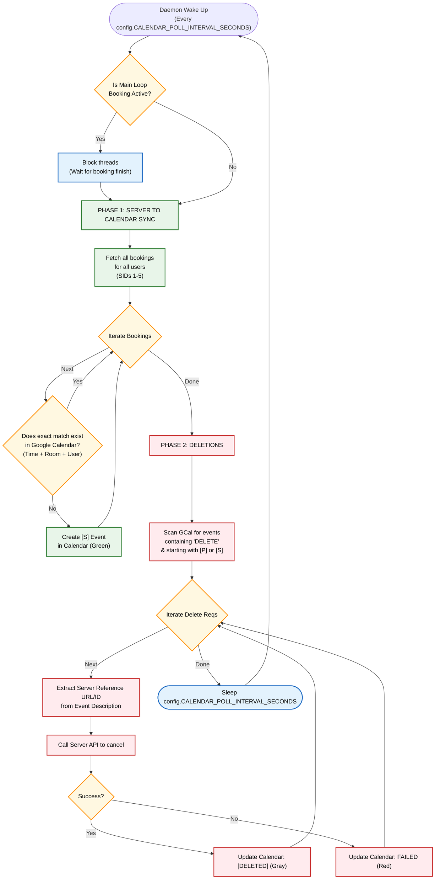

# Booking Rules & Business Logic

This document is the **Source of Truth** for all business rules, timing constraints, and logic governing the Booking Agent.

## 1. Timing & Booking Windows

### The Core Formula (7 Days - 1 Hour)
The university library system releases slots exactly 7 days in advance, but with a 1-hour positive offset. This is the critical timing constraint that drives the entire sniping strategy.

```
Opening Time = Target Slot Time - 7 Days + 1 Hour
```

**Examples:**
| Target Slot | Opens At |
|-------------|----------|
| Friday 10:00 AM | Previous Friday 11:00 AM |
| Monday 14:00 | Previous Monday 15:00 |
| Sunday 08:00 | Previous Sunday 09:00 |

### Pre-Booking Wait Strategy
When processing a booking request prior to its opening:
1.  **Initial Wait (>60s):** The system sleeps until exactly `T-60` seconds before the `Opening Time`. At this point, it wakes up and forcefully re-logs in all agents to ensure fresh session cookies and CSRF tokens.
2.  **Final Wait (<60s):** The system sleeps again until exactly `T-5` seconds.
3.  **Execution (T-5s):** The booking loop begins firing requests slightly early to account for network latency and to catch the exact millisecond the window opens.

## 2. Reservation Constraints & Limits

### Duration
*   Bookings are made in **1-hour intervals**.
*   The system treats each hour as a separate, distinct booking attempt.

### 3-Hour Maximum Rule
*   **Atomic 1-Hour Decomposition:** Multi-hour Google Calendar events are decomposed upfront into atomic 1-hour chunks on Google Calendar (updating the original event to the first hour and inserting new events for subsequent hours). Each 1-hour chunk is processed independently.
*   **Combined/Merged Prevention:** The system merges consecutive slots if they share the same room and user, but strictly enforces the `config.MAX_SINGLE_BOOKING_DURATION_HOURS` (3 hours) limit, keeping subsequent hours (e.g., hour 4) as distinct, independent events.

### User Quotas
Each university account has undocumented daily and weekly booking limits. The `BookingAgent` bypasses individual limits by treating multiple accounts as a collective pool.

**Exhaustion Logic:**
*   **Detection:** The server API returns an error containing `"limited"`.
*   **Exhaustion Action:** The user account is marked as exhausted **for the duration of that specific booking attempt loop only**.
*   *Note: An agent is not permanently marked as "exhausted" globally. This is because a quota slot might open up later in the day due to a manual cancellation. The system must be free to try the agent again on the next booking cycle.*
*   **Authentication Quarantine:** If an account fails authentication or session creation, it is quarantined from `get_rotational_agents()`. This prevents repeated synchronous login timeouts from blocking active sniping attempts across room batches.

### Room Priority Hierarchy
Rooms are grouped into batches to ensure the best possible locations are secured first.

*   **High Priority (Tier 1):** Rooms 108, 109, 110, 111 (IDs 125-128). Always attempted first.
*   **Low Priority (Tier 2):** Rooms 13, 14, 15, 16 (IDs 23-26). Only attempted if all High Priority rooms return conflict errors (`ROOM_TAKEN`).

## 3. High-Level Automation Cycles

The following diagrams illustrate the high-level orchestration of the system's primary cycles. For lower-level, implementation-specific flowcharts (like the attack loop retry mechanisms), see `docs/diagrams.md`.

### A. The Main Scanning Cycle (Google Calendar Input)
This loop runs continuously to find new, unprocessed booking requests added by the user to their Google Calendar.



### B. The Sync & Delete Cycle (Server Output)
This background daemon runs every 5 minutes (by default) to ensure Google Calendar accurately reflects the state of the Bookings server, and processes user deletion requests. This cycle pauses itself if the main loop is actively executing an "Attack".



## 4. Multi-Hour Logic (Upfront Splitting and Merging)

### Upfront Splitting
When a user requests a multi-hour block (e.g., 10:00-14:00) using a single calendar event:
1. **Upfront Decomposition:** The system automatically decomposes the multi-hour event on Google Calendar into consecutive 1-hour `Booking:` events.
2. **Atomic Processing:** Each 1-hour block is processed independently with its own exact opening time (`Slot Start - 7 Days + 1 Hour`). This completely eliminates runtime degradation loops and multi-hour state machines.

### Consecutive Priority & Merging
For each 1-hour slot being booked:
1. **Preceding Detection:** The system inspects Google Calendar for an existing successful booking whose end time matches the current slot's start time (`event.end == current.start`).
   - Failed (`colorId=11`), deleted (`colorId=8`), or in-progress (`colorId=5`) events are strictly excluded.
   - Events marked `[DELETED]`, `[D]`, or `[FAILED]` in their summaries are ignored.
   - This detects preceding bookings even if previous hours (e.g. Hours 1, 2, and 3) were already merged into a single multi-hour block.
2. **Prioritization:**
   - **Priority 1 (Room):** Target the same room as the preceding booking (so the user remains in the same room).
   - **Priority 2 (User):** Target the same user account.
3. **Merging:**
   - If the slot succeeds with the **same room** and **same user**, and the total combined duration does not exceed `config.MAX_SINGLE_BOOKING_DURATION_HOURS` (3 hours), the system merges the events in Google Calendar:
     - The preceding event's end time is extended to cover the new slot.
     - The reference number is appended to the description.
     - The current slot's separate event is deleted.
   - If the combined duration would exceed 3 hours (e.g. Hour 4) or if a different room/user was used, the booking remains as an independent green event in the same room, strictly honoring the university's 3-hour limit per reservation.
   - In `CalendarSync`, duplicate detection checks for exact reference numbers across all descriptions first. This prevents creating duplicate `[S]` events when server reservations correspond to subsequent hours of an already merged multi-hour event.
